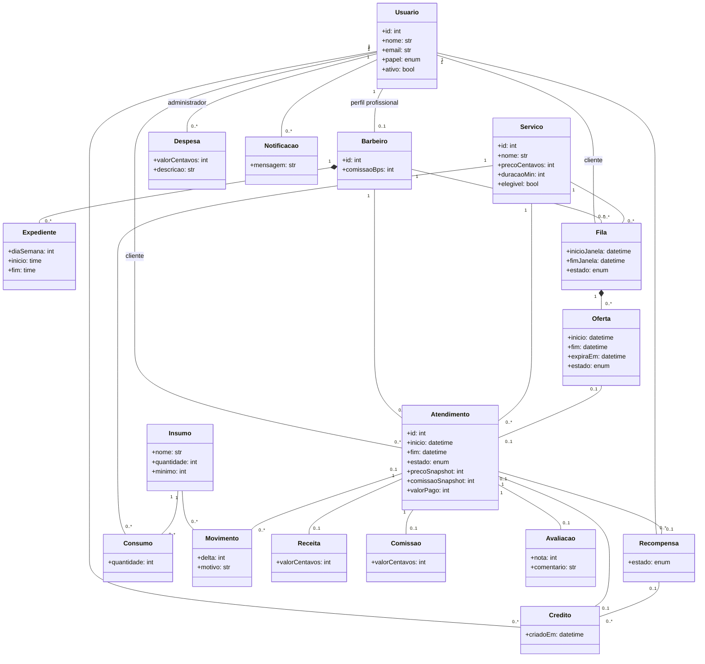
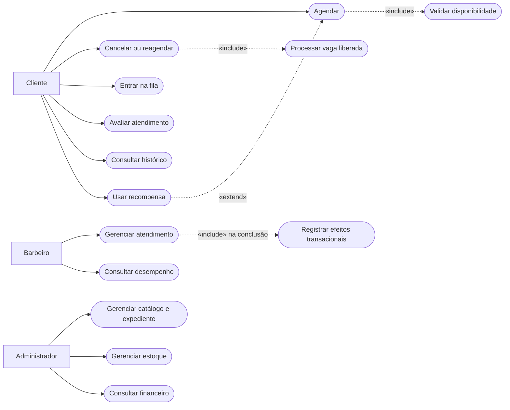
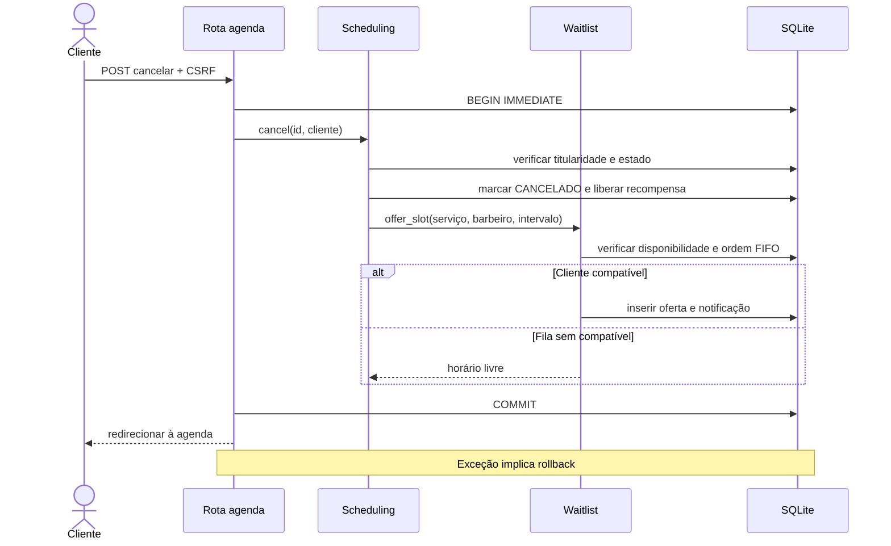

# Modelos UML — BarberFlow

Visões conceituais derivadas da spec; não afirmam que a implementação Python usa classes ORM. As entidades são persistidas em SQLite, e os serviços de aplicação são funções em módulos.

## Diagrama de classes do domínio

## Casos de uso (representação Mermaid)

## Sequência — cancelamento e fila

Modelo de domínio, estados e sequência de conclusão: [spec.md](../spec.md).
