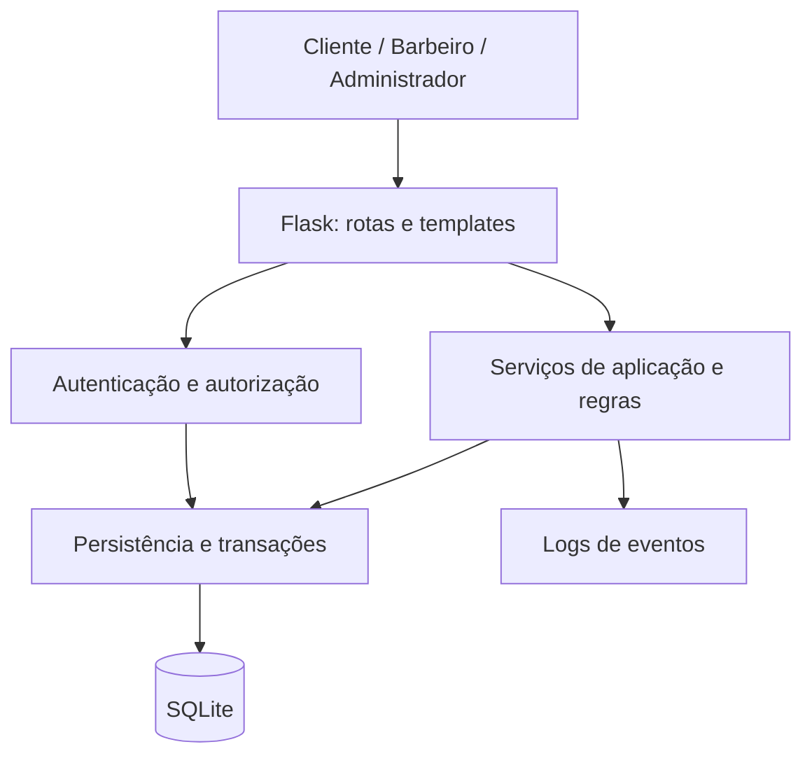

# BarberFlow — Planejamento técnico

**Versão:** 0.1, proposta para revisão | **Issue:** #2 | **Dependência:** [spec.md](spec.md), versão 0.1 incorporada no PR #17.
Este plano descreve o caminho de implementação, não afirma que código ou testes já existem. Se houver conflito, a spec prevalece; a mudança de escopo deve ser revisada antes do código.

## 1. Objetivo e abordagem

Entregar uma aplicação web responsiva de gestão de uma barbearia, com três perfis e uma transação integrada de conclusão de atendimento. A primeira entrega executável deve demonstrar autenticação, agenda, conclusão, estoque, receita, comissão e fidelidade. Fila de espera, histórico, avaliações e painéis completam o MVP planejado. Se o prazo impedir alguma entrega, registrar a lacuna e revisar o escopo de modo explícito.

### Stack proposta

| Componente | Escolha | Justificativa |
| --- | --- | --- |
| Runtime | Python 3.12 | Simplicidade, biblioteca padrão e disponibilidade |
| Web | Flask 3.1 e Jinja2 | Monólito leve, renderização no servidor |
| Persistência | SQLite via sqlite3 | Banco local, transações ACID, sem servidor adicional |
| Interface | HTML semântico, CSS próprio, JavaScript progressivo | Responsividade sem build frontend |
| Segurança | Werkzeug para hash de senha; Flask-WTF para CSRF | Bibliotecas consolidadas |
| Testes | pytest e cliente de teste Flask | Casos isolados e integração HTTP |
| Automação | GitHub Actions, Python 3.12 | Executar suíte a cada PR e push na main |
| Modelagem | Markdown e Mermaid | Artefatos versionáveis e revisáveis |

Fixar versões efetivamente instaladas e testadas no requirements.txt antes da entrega. Não depender de APIs pagas, CDN ou serviços externos para o fluxo central. Pagamentos são registros manuais, não processamento real.

## 2. Arquitetura



Monólito modular com dependência das rotas para serviços e persistência, nunca no sentido inverso. Rotas validam formato e sessão; serviços verificam titularidade, regras e estados; repositórios usam SQL parametrizado. Uma unidade de trabalho controla a transação, sem commits intermediários em funções chamadas por ela.

| Módulo | Responsabilidade | Requisitos |
| --- | --- | --- |
| auth | Cadastro de cliente, login/logout, sessão, autorização | RF-01–03, RNF-01–02 |
| catalog | Serviços, equipe, expediente e configuração | RF-04–06, RF-24 |
| scheduling | Disponibilidade, reserva, reagendamento, cancelamento e início/ausência | RF-07–12, RF-14 |
| waitlist | Compatibilidade, oferta exclusiva, expiração, aceitação e notificação | RF-15–19 |
| operations | Conclusão integrada e idempotência | RF-13, RF-36, RNF-04 |
| loyalty | Créditos, conversão e resgate | RF-20–23 |
| inventory | Insumos, consumo, movimentações e alertas | RF-24–27 |
| finance | Receitas, comissões, despesas e totais | RF-28–30 |
| dashboards | Indicadores, agenda do barbeiro, interface administrativa | RF-31–32 |
| customer | Histórico, notificações, avaliações e perfil | RF-33–35 |

## 3. Estrutura prevista

```text
BarberFlow/
  README.md
  spec.md
  plan.md
  tasks.md
  requirements.txt
  .gitignore
  .specify/
    README.md
  .github/workflows/tests.yml
  docs/
    adr/
    review/
    security.md
    testing.md
  src/
    __init__.py
    db.py
    schema.sql
    auth.py
    catalog.py
    scheduling.py
    waitlist.py
    operations.py
    loyalty.py
    inventory.py
    finance.py
    dashboards.py
    customer.py
    templates/
    static/
  tests/
    conftest.py
    test_auth.py
    test_scheduling.py
    test_waitlist.py
    test_operations.py
    test_loyalty.py
    test_inventory.py
    test_finance.py
    test_customer.py
  instance/
    barberflow.sqlite3 (local, ignorado pelo Git)
```

A organização interna pode ser refinada no código mantendo separação de responsabilidades. As pastas /docs, /src, /tests e /.specify são obrigatórias. Não versionar banco real, senhas, arquivos de ambiente nem chaves.

## 4. Modelo físico proposto

SQLite com chaves estrangeiras habilitadas em toda conexão, índices para consultas frequentes e restrições CHECK/UNIQUE como segunda camada de defesa. Identificadores inteiros; moeda em centavos inteiros; comissão em pontos-base (0–10000); quantidades inteiras; timestamps UTC normalizados para comparação e convertidos para America/Sao_Paulo na interface.

| Tabela | Campos principais e restrições |
| --- | --- |
| users | id PK, name, email UNIQUE normalizado, password_hash, role CHECK client/barber/admin, active |
| barbers | id PK, user_id FK UNIQUE, commission_bps CHECK 0–10000 |
| working_hours | id PK, barber_id FK, weekday 0–6, start_time, end_time; início menor que fim, sem sobreposição |
| services | id PK, name, description, image_path opcional, price_cents >=0, duration_min >0, loyalty_eligible, active |
| appointments | id PK, client_id FK, barber_id FK, service_id FK, start_at, end_at, status CHECK, price_cents_snapshot, commission_bps_snapshot, paid_cents, completed_at; fim maior que início |
| supplies | id PK, name, quantity >=0, min_quantity >=0, active |
| service_supplies | service_id FK, supply_id FK, quantity >0; PK composta |
| stock_movements | id PK, supply_id FK, appointment_id FK opcional, delta !=0, reason, created_at; índice único para baixa por atendimento/insumo |
| revenues | id PK, appointment_id FK UNIQUE, amount_cents >0, created_at |
| commissions | id PK, appointment_id FK UNIQUE, amount_cents >=0, created_at |
| expenses | id PK, admin_id FK, description, amount_cents >0, occurred_at |
| rewards | id PK, client_id FK, status CHECK available/reserved/used, appointment_id FK UNIQUE opcional, created_at |
| loyalty_credits | id PK, client_id FK, appointment_id FK UNIQUE, reward_id FK opcional, created_at |
| waitlist | id PK, client_id FK, service_id FK, barber_id FK, window_start, window_end, created_at, status |
| offers | id PK, waitlist_id FK, start_at, end_at, expires_at, status, appointment_id FK UNIQUE opcional |
| reviews | id PK, appointment_id FK UNIQUE, rating CHECK 1–5, comment, created_at |
| notifications | id PK, user_id FK, message, created_at, read_at opcional |

Índices: appointments(barber_id,start_at,end_at,status), appointments(client_id,start_at), waitlist(barber_id,service_id,status,created_at,id), offers(status,expires_at), stock_movements(supply_id,created_at), revenues/commissions(created_at), expenses(occurred_at). Não excluir registros históricos com dependências; desativar catálogo e equipe.

O banco deve restringir duplicidade estrutural, mas sobreposição temporal e titularidade exigem validação transacional. Armazenar o consumo associado ao serviço e aplicar a configuração vigente no momento da conclusão, conforme RN-05; o histórico da movimentação preserva a quantidade realmente utilizada. Alterações de expediente não invalidam reservas existentes silenciosamente: bloquear mudanças conflitantes ou tratar explicitamente em revisão da spec.

## 5. Fluxos críticos e transações

### 5.1 Reserva e fila
1. Normalizar data e horário, validar perfil, catálogo e expediente.
2. Em transação de escrita BEGIN IMMEDIATE, processar ofertas expiradas aplicáveis e consultar intervalos ativos.
3. Detectar conflito pela condição inicio_existente < fim_novo AND fim_existente > inicio_novo. Incluir ofertas pendentes válidas do mesmo barbeiro.
4. Criar reserva ou converter oferta do titular; congelar preço e comissão; reservar recompensa se solicitada; confirmar transação.
5. Ao cancelar/reagendar, liberar intervalo anterior e eventual recompensa; selecionar fila compatível FIFO, com desempate por id. Oferta válida até min(agora+15 min, início da vaga). Criar notificação.
6. Ao recusar/expirar, marcar oferta terminal e avançar para o próximo registro elegível. Não ofertar horários já iniciados, nem repetir oferta ao mesmo registro. Sem candidatos, liberar vaga. Processar expirações por interação, conforme spec, sem prometer execução em segundo plano.

### 5.2 Atendimento integrado
1. Verificar sessão e titularidade do barbeiro, estado EM_ATENDIMENTO e pagamento integral do preço congelado (ou recompensa válida de valor zero).
2. Abrir transação de escrita e reler estado; verificar disponibilidade de todos os insumos.
3. Registrar baixas, receita e comissão sobre o valor pago (zero no resgate), crédito apenas se elegível e pago; converter grupos de dez créditos em recompensas; consumir recompensa reservada se aplicável.
4. Atualizar estado CONCLUIDO e timestamp; confirmar tudo junto.
5. Em qualquer falha, rollback completo; repetir solicitação não duplica registros. A regra de estoque insuficiente mantém atendimento em andamento até reposição.

### 5.3 Indicadores
Receitas, comissões e despesas filtradas por intervalo de competência. Resultado = receitas − despesas − comissões. Ticket médio, visitas, gastos, avaliação média e ocupação seguem RN-17–19; não usar dados fixos como se fossem reais. Dados de demonstração claramente identificados.

## 6. Interfaces propostas

| Área | Rotas conceituais | Acesso |
| --- | --- | --- |
| Sessão | /login, /register, /logout | Público para login/cadastro; sessão para sair |
| Cliente | /cliente, /servicos, /agendamentos, /fila, /recompensas, /historico, /notificacoes | Cliente e titularidade |
| Barbeiro | /barbeiro, /barbeiro/agenda, /barbeiro/atendimentos, /barbeiro/comissoes | Barbeiro e titularidade |
| Administração | /admin, /admin/servicos, /admin/equipe, /admin/estoque, /admin/financeiro | Administrador |
 
GET consulta; POST altera estado com CSRF, validação no servidor e padrão post/redirect/get. Formulários devem exibir erros úteis sem revelar detalhes internos. Interface em português, moeda BRL, visual preto/dourado, responsiva em 360 e 1280 px.

## 7. Segurança, confiabilidade e observabilidade

- Senhas com hash salgado via Werkzeug, nunca texto claro; primeiro admin por comando local e segredo de sessão fora do Git.
- Sessão limpa após login/logout, cookies HttpOnly e SameSite=Lax; Secure em HTTPS. Cadastro público não escolhe papel administrativo.
- CSRF em mutações; autorização por rota e por objeto; SQL parametrizado; autoescape de templates; validação de limites, tipos e valores.
- Sem dados pessoais reais no repositório público. Logs sem senhas, tokens ou informações de pagamento sensíveis.
- Registrar login falho sem credencial, ações administrativas e falhas de transação com identificador de operação e resultado.
- SQLite com timeout de lock, transações curtas; capturar falhas sem efeitos parciais. Backup local seguro como procedimento futuro de operação.
- Não declarar segurança de produção: revisão, TLS, rate limiting, recuperação de conta e política de retenção precisam de avaliação antes de uso comercial.

## 8. Estratégia de testes e qualidade

| Camada | Evidência esperada |
| --- | --- |
| Unitária | Cálculos em centavos, intervalos, compatibilidade FIFO, comissão, indicadores, limites de fidelidade |
| Integração | Banco temporário por teste, autenticação, permissões, operações transacionais e persistência |
| Fluxo completo | CT-01–12 da spec, incluindo agendamento e conclusão com estoque, financeiro e fidelidade |
| Concorrência | Duas tentativas conflitantes de reserva/aceitação e conclusão repetida; somente uma operação válida |
| Segurança | CSRF, tentativa de acesso a dados alheios, entrada inválida, SQLi/XSS e hash de senha |
| Interface | Verificar navegação por perfil em viewports 360 e 1280 px |
| Performance | RNF-06: p95 de 30 requisições sequenciais com 1.000 atendimentos, ambiente documentado |
| Observabilidade | RNF-07: inspecionar eventos sem segredos |

Executar pytest -q e registrar comando, ambiente e resultado real. CI deve falhar em teste com erro. Evidências manuais e métricas ainda pendentes; não inventar números nem apresentar cenário planejado como teste executado.

## 9. Sequência de implementação e dependências

1. Aprovar planejamento, tarefas e ADRs (#2–4).
2. Infraestrutura, schema, auth, perfis e fixture de demonstração (#5).
3. Catálogo, equipe e agenda (#6) com operações de estado inicialmente integradas por contrato.
4. Fila (#7), fidelidade (#8), estoque (#9), financeiro (#10); integrar conclusão sem efeitos parciais.
5. Interfaces e painéis (#11–12), histórico e avaliações (#13).
6. Testes contínuos por módulo e integração final (#14).
7. Revisão multidimensional, SSDLC e remediação (#15).
8. README, instruções verificadas, documentação e entrega (#16).

Pedro e Gianlucca mantêm suas responsabilidades nas Issues. Cada implementação deve ter branch, PR vinculado, evidência e revisão humana cruzada; não atribuir contribuição humana a trabalho feito apenas pelo agente. Os PRs de planejamento podem ser revisados em paralelo, mas divergências devem ser corrigidas antes da implementação.

## 10. Operação local planejada

Após criação do código: criar ambiente virtual, instalar requirements.txt, definir segredo de sessão, inicializar banco, criar contas de teste com comando documentado, executar Flask e abrir localhost. Os comandos exatos serão validados na entrega; não são instruções já testadas. Registrar limitações e itens adiados no README.

## 11. Riscos e definição de pronto

| Risco | Mitigação |
| --- | --- |
| Escopo amplo e prazo curto | Priorizar fluxo integrado; revisar backlog e spec se algum módulo for adiado |
| Corrida por reserva ou duplo clique | Transações de escrita, revalidação e restrições únicas |
| Divergência spec/código | Matriz requisito → tarefa → teste; revisão de PR |
| Vazamento em repo público | Segredos fora do Git, dados fictícios, controle de acesso |
| SQLite em múltiplos processos | MVP local de baixa concorrência; validar limites e planejar migração futura |
| Aprovação e contribuição individual insuficientes | Revisões reais, tarefas por integrante; registrar apenas histórico efetivo |

Uma entrega está pronta quando cumpre os critérios de aceite aplicáveis, possui evidências reais, está alinhada à spec, tem PR revisado e merge autorizado. Pendências devem ficar abertas ou ser reclassificadas explicitamente. Não há testes executados nesta etapa documental.

**Elaboração assistida por IA.** Escolhas de stack, detalhes físicos e controles propostos sujeitos à validação dos integrantes. Os ADRs serão registrados em docs/adr.
