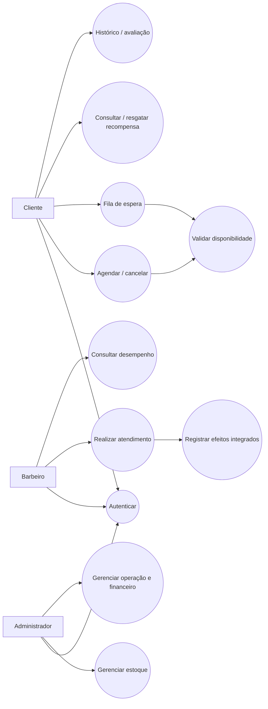
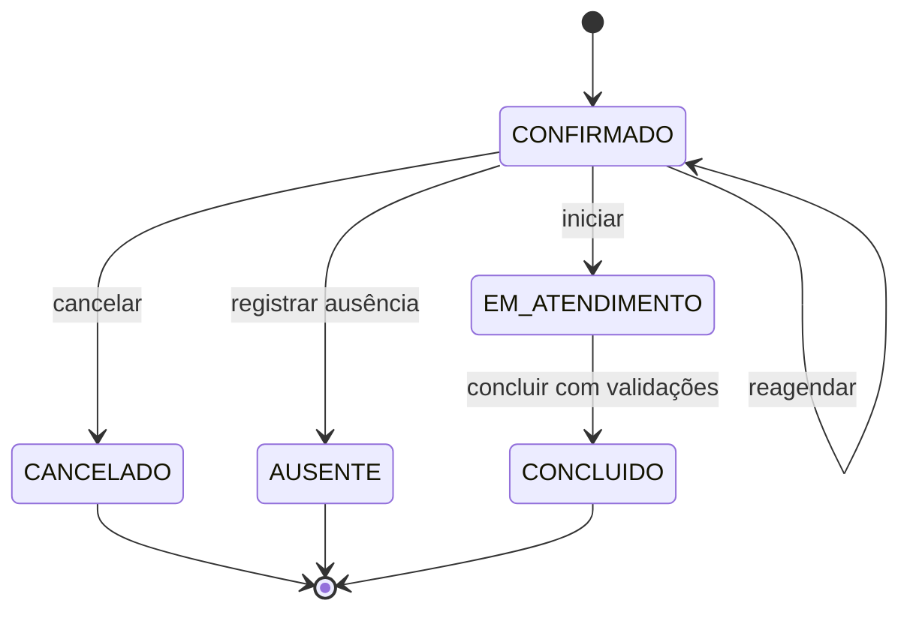
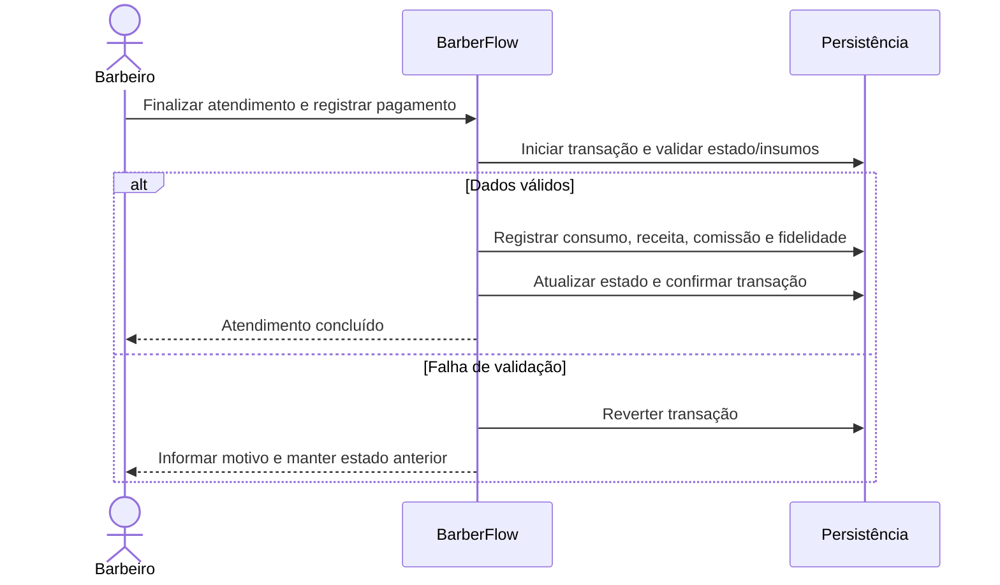
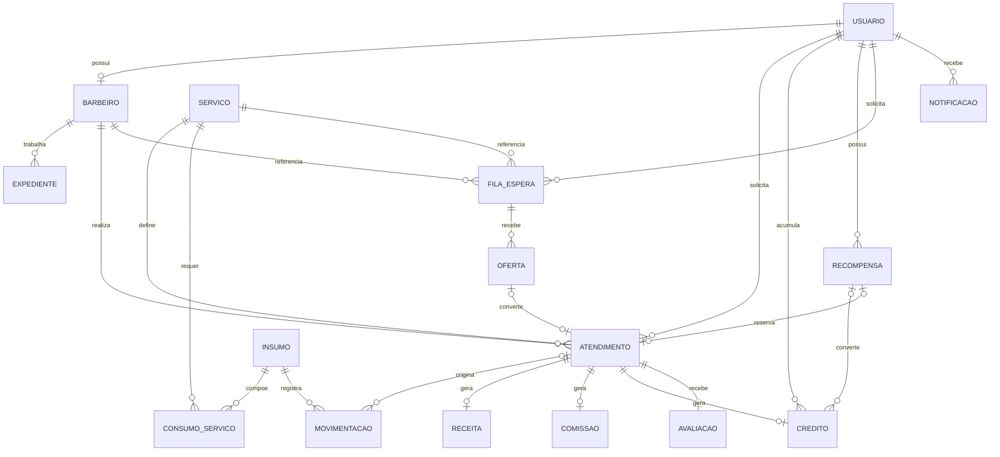

# BarberFlow — Especificação do sistema

**Versão:** 0.1 (proposta para revisão) | **Disciplina:** Modelagem de Software, 2026-2, Mackenzie  
**Equipe:** Pedro e Gianlucca 10737829 (ItsNeymar) | **Issue:** #1

Esta especificação é a fonte de verdade do comportamento esperado do MVP. Os requisitos são compromissos propostos, não funcionalidades já implementadas. Alterações devem passar por revisão e atualizar os requisitos, tarefas e testes correspondentes.

## 1. Problema, objetivos e escopo

Barbearias pequenas podem perder horários por cancelamentos e controlar agenda, estoque, comissões e fidelidade em ferramentas separadas. Isso aumenta retrabalho e dificulta o acompanhamento do negócio e da experiência do cliente. O BarberFlow propõe uma aplicação web integrada para uma barbearia, na qual o atendimento conecta agenda, estoque, financeiro e recompensas.

**Objetivos:** evitar conflitos de agenda; reaproveitar horários cancelados; automatizar registros de atendimento; incentivar recorrência; tornar estoque e resultados visíveis; separar permissões por perfil.

**MVP planejado:** autenticação, catálogo, gestão de equipe e horários, agenda, fila de espera, atendimento, fidelidade, estoque, financeiro, comissões, painéis, histórico, avaliações e notificações internas. Priorizar fluxo integrado e testes das regras críticas. Funcionalidades não concluídas deverão ser explicitamente reclassificadas em revisão da spec e nas issues, sem simular sua implementação.

**Fora do escopo:** integração de pagamento real, WhatsApp/SMS, aplicativo nativo, inteligência artificial dentro do produto, múltiplas filiais, venda online de produtos, emissão fiscal e folha de pagamento. O agente de codificação auxilia o desenvolvimento, não decide regras do sistema.

## 2. Personas e permissões

| Persona (hipotética) | Necessidade | Permissões |
| --- | --- | --- |
| Cliente — pessoa que frequenta a barbearia | Encontrar preço e horário, remarcar, acompanhar visitas e benefícios | Consultar catálogo; criar e cancelar próprios agendamentos; entrar na fila; resgatar recompensa própria; avaliar e consultar histórico e notificações próprios |
| Barbeiro — profissional de atendimento | Organizar agenda, registrar serviço e consultar ganhos | Consultar agenda e atendimentos próprios; iniciar, concluir ou registrar ausência; consultar comissões e avaliações próprias |
| Administrador — gestor da barbearia | Gerenciar operação, equipe, estoque e resultado | Gerenciar serviços, profissionais, horários, estoque, despesas e configurações comerciais; consultar indicadores e atendimentos; sem acesso às senhas |

As personas representam hipóteses do grupo, não entrevistas realizadas. Cadastro público cria apenas clientes; contas de barbeiros e administradores são provisionadas por administração autorizada (primeiro administrador via inicialização local).

## 3. Glossário e premissas

- Atendimento: reserva vinculada a cliente, barbeiro e serviço, com início/fim previstos e estado.
- Crédito: unidade de fidelidade obtida por corte elegível, pago e concluído.
- Recompensa: direito a um corte elegível gratuito após dez créditos; não é dinheiro.
- Insumo: item consumido na prestação de um serviço, medido em unidades inteiras no MVP.
- Oferta: reserva temporária de uma vaga a um cliente da fila de espera.
- Pagamento: registro manual de recebimento; não envolve processamento bancário.
- Preço e comissão são congelados no momento da reserva; mudanças valem para novas reservas.
- Valores em BRL, representados em centavos; horários exibidos no fuso America/Sao_Paulo.
- Horário de trabalho e duração são configuráveis; intervalos de reserva são semiabertos [início, fim), portanto horários adjacentes são permitidos.

## 4. Requisitos em EARS

Cada requisito possui identificador estável. Padrões utilizados: universal (O sistema deve...), orientado a evento (Quando...), orientado a estado (Enquanto...) e comportamento indesejado (Se..., então...). A coluna Issue vincula o requisito ao trabalho registrado.

### 4.1 Requisitos funcionais

| ID | Requisito EARS | Issue |
| --- | --- | --- |
| RF-01 | Quando um visitante informar dados válidos e e-mail ainda não cadastrado, o sistema deve criar uma conta de cliente. | #5 |
| RF-02 | Quando um usuário apresentar credenciais válidas, o sistema deve iniciar uma sessão autenticada; quando solicitar sair, deve encerrá-la. | #5 |
| RF-03 | Se uma operação exigir permissão que o usuário não possui, então o sistema deve negar a operação sem alterar dados. | #5 |
| RF-04 | O sistema deve permitir ao administrador cadastrar, editar e desativar serviços com nome, descrição, preço, duração e elegibilidade à fidelidade. | #6 |
| RF-05 | O sistema deve exibir aos clientes serviços ativos, preços, duração e imagem quando cadastrada. | #6, #11 |
| RF-06 | O sistema deve permitir ao administrador gerenciar barbeiros, horários de trabalho e percentual de comissão. | #5, #12 |
| RF-07 | Quando o cliente selecionar serviço, barbeiro e data, o sistema deve exibir horários disponíveis que comportem a duração integral do serviço. | #6 |
| RF-08 | Quando o cliente solicitar uma reserva válida, o sistema deve persistir o atendimento confirmado com preço e comissão vigentes. | #6 |
| RF-09 | Se a reserva conflitar com atendimento ou oferta ativa do mesmo barbeiro, estiver no passado ou fora do expediente, então o sistema deve rejeitá-la sem criar conflito. | #6, #7 |
| RF-10 | Quando o cliente cancelar atendimento próprio ainda confirmado e não iniciado, o sistema deve cancelá-lo e disponibilizar o horário à fila de espera. | #6, #7 |
| RF-11 | Quando o cliente solicitar reagendamento válido de atendimento confirmado, o sistema deve substituir o horário de forma atômica e liberar o horário anterior; se inválido, deve preservar o horário original. | #6, #7 |
| RF-12 | Quando o barbeiro responsável iniciar atendimento confirmado, o sistema deve alterar o estado para EM_ATENDIMENTO. | #6, #12 |
| RF-13 | Quando o barbeiro responsável finalizar atendimento em andamento com pagamento registrado ou recompensa válida, o sistema deve concluir o atendimento e registrar os efeitos de estoque, financeiro e fidelidade em uma única transação. | #6, #8, #9, #10 |
| RF-14 | Quando o barbeiro responsável registrar ausência após o início previsto de um atendimento confirmado, o sistema deve alterar seu estado para AUSENTE sem gerar receita, comissão ou crédito. | #6, #12 |
| RF-15 | Quando o cliente informar preferências válidas de serviço, barbeiro e janela de horário futura, o sistema deve registrar sua entrada na fila de espera; deve permitir sua retirada enquanto não houver reserva confirmada. | #7 |
| RF-16 | Quando uma vaga compatível for liberada por cancelamento ou reagendamento, o sistema deve ofertá-la ao cliente elegível mais antigo da fila, gerar uma notificação interna e definir prazo de confirmação. | #7 |
| RF-17 | Enquanto uma oferta estiver ativa, o sistema deve reservar exclusivamente a vaga ao cliente destinatário até aceitação, recusa ou expiração. | #7 |
| RF-18 | Quando o destinatário aceitar uma oferta dentro do prazo, o sistema deve revalidar a disponibilidade e converter a oferta em atendimento confirmado de forma atômica. | #7 |
| RF-19 | Quando uma oferta for recusada ou expirar, o sistema deve encerrar a oferta e buscar o próximo cliente compatível; se não houver, deve liberar a vaga ao catálogo de horários. | #7 |
| RF-20 | Quando um corte elegível, pago e concluído atingir os critérios de fidelidade, o sistema deve registrar exatamente um crédito vinculado ao atendimento. | #8 |
| RF-21 | Quando o saldo de créditos não convertidos atingir dez, o sistema deve convertê-los em uma recompensa disponível e preservar os créditos excedentes. | #8 |
| RF-22 | Quando o cliente solicitar o uso de recompensa própria disponível em um corte elegível, o sistema deve reservá-la ao atendimento; ao concluir, deve consumi-la; ao cancelar ou registrar ausência, deve liberá-la. | #8 |
| RF-23 | O sistema deve exibir ao cliente seu saldo de créditos, recompensas disponíveis e histórico de visitas. | #8, #11, #13 |
| RF-24 | O sistema deve permitir ao administrador cadastrar insumos, quantidade mínima, entradas, saídas e consumo previsto por serviço. | #9 |
| RF-25 | Quando um atendimento for concluído, o sistema deve registrar uma baixa por insumo associado e preservar o histórico de movimentações. | #9 |
| RF-26 | Se uma saída ou conclusão resultar em estoque negativo, então o sistema deve rejeitar toda a operação e informar o insumo insuficiente. | #9 |
| RF-27 | Enquanto a quantidade de um insumo ativo for menor ou igual ao mínimo definido, o sistema deve apresentar alerta de reposição ao administrador. | #9, #12 |
| RF-28 | Quando um atendimento pago for concluído, o sistema deve registrar uma receita e uma comissão calculada sobre o valor efetivamente pago. | #10 |
| RF-29 | O sistema deve permitir ao administrador registrar despesas operacionais com valor, descrição e data e consultar o financeiro por período. | #10 |
| RF-30 | O sistema deve apresentar faturamento, comissões, despesas e resultado operacional estimado por período ao administrador. | #10, #12 |
| RF-31 | O sistema deve exibir ao administrador atendimentos concluídos, ticket médio, ocupação e alertas de estoque, calculados a partir dos registros persistidos. | #12 |
| RF-32 | O sistema deve exibir ao barbeiro sua agenda, atendimentos concluídos, avaliação média e comissões por período. | #12 |
| RF-33 | O sistema deve permitir ao cliente consultar seus próximos atendimentos, histórico, total de visitas, gastos acumulados e notificações internas. | #11, #13 |
| RF-34 | Quando o cliente enviar uma avaliação de 1 a 5 para seu próprio atendimento concluído ainda não avaliado, o sistema deve persistir a avaliação e atualizar a média consultável. | #13 |
| RF-35 | Se uma avaliação for duplicada, tiver nota inválida ou pertencer a atendimento não concluído ou de outro cliente, então o sistema deve rejeitá-la. | #13 |
| RF-36 | Quando uma operação tentar repetir os efeitos de conclusão de um atendimento já concluído, o sistema deve impedir duplicidade de receitas, comissões, créditos e baixas. | #6, #8, #9, #10 |

### 4.2 Requisitos não funcionais

| ID | Requisito EARS | Verificação planejada | Issue |
| --- | --- | --- | --- |
| RNF-01 | O sistema deve armazenar senhas somente como hashes com salt por meio de função de derivação segura de biblioteca consolidada. | Inspecionar armazenamento e código; testar autenticação. | #5, #15 |
| RNF-02 | O sistema deve validar autorização e entradas no servidor em todas as operações protegidas. | Testes de acesso indevido, dados inválidos e titularidade. | #5, #14, #15 |
| RNF-03 | O sistema deve preservar dados confirmados após reinicialização da aplicação. | Reiniciar em ambiente de teste e consultar registros. | #5, #14 |
| RNF-04 | Quando uma operação de conclusão falhar em qualquer etapa, o sistema deve reverter todos os efeitos da transação. | Simular estoque insuficiente e confirmar ausência de efeitos parciais. | #9, #10, #14 |
| RNF-05 | O sistema deve apresentar telas centrais utilizáveis em viewport de 360 e 1280 pixels sem rolagem horizontal da página. | Inspeção manual em ambos os tamanhos. | #11, #12, #14 |
| RNF-06 | O sistema deve responder a consultas locais de agenda e dashboard em até 2 segundos no percentil 95 de 30 requisições sequenciais, com 1.000 atendimentos de teste, em ambiente documentado. | Medição local reproduzível; meta proposta, não resultado medido. | #14, #15 |
| RNF-07 | Quando ocorrer erro de operação ou ação administrativa relevante, o sistema deve registrar evento com horário, operação e resultado, sem senhas ou tokens. | Inspecionar logs de eventos de teste. | #15 |
| RNF-08 | O sistema deve proteger requisições de alteração de estado contra CSRF, utilizar consultas parametrizadas e escapar dados exibidos. | Revisão de código e testes de entradas maliciosas. | #5, #15 |
| RNF-09 | O sistema deve documentar instalação, inicialização, execução de testes e limitações no repositório. | Execução em ambiente limpo e revisão do README. | #16 |

## 5. Regras de negócio

| ID | Regra verificável | Requisitos |
| --- | --- | --- |
| RN-01 | Reservas confirmadas, em atendimento e ofertas ativas do mesmo barbeiro não podem se sobrepor. | RF-07–09, RF-17–18 |
| RN-02 | A reserva deve começar no futuro, comportar a duração integral e respeitar o expediente configurado; apenas serviços e profissionais ativos podem receber novas reservas. | RF-07–09 |
| RN-03 | Dez cortes elegíveis, pagos e concluídos geram exatamente uma recompensa. Crédito excedente permanece no saldo. | RF-20–21 |
| RN-04 | Atendimento cancelado, ausente, gratuito ou não elegível não gera crédito. | RF-14, RF-20–22 |
| RN-05 | Concluir atendimento consome a quantidade de cada insumo associado, inclusive no corte gratuito. | RF-13, RF-25 |
| RN-06 | Estoque menor ou igual ao mínimo dispara alerta enquanto persistir a condição. | RF-27 |
| RN-07 | Comissão = valor pago em centavos × percentual contratado, arredondado ao centavo mais próximo (meio para cima); recompensa gratuita gera comissão zero no MVP. | RF-08, RF-28 |
| RN-08 | Cancelamento ou reagendamento libera vaga e aciona fila compatível por ordem de entrada, desempate pelo identificador crescente. | RF-10–11, RF-15–19 |
| RN-09 | Apenas o titular de atendimento concluído pode enviar uma avaliação, uma única vez, com nota inteira de 1 a 5. | RF-34–35 |
| RN-10 | Apenas administrador altera preços, serviços, expediente, equipe e estoque; regras fixas do MVP exigem alteração versionada da spec para mudar. | RF-03–06, RF-24 |
| RN-11 | Efeitos de conclusão são únicos por atendimento (e por insumo, no estoque) e transacionais. | RF-13, RF-36, RNF-04 |
| RN-12 | Quantidades de estoque nunca são negativas. Saída insuficiente bloqueia conclusão até reposição. | RF-25–26 |
| RN-13 | Oferta dura até 15 minutos ou até o início da vaga, o que ocorrer primeiro; após o prazo não pode ser aceita. Somente uma oferta ativa por vaga. | RF-16–19 |
| RN-14 | Fila compatível exige mesmo serviço, barbeiro indicado e intervalo que comporte a vaga; recusas/expirações não repetem a oferta ao mesmo registro de fila. | RF-15–19 |
| RN-15 | Recompensa própria fica reservada a um único atendimento; consumo definitivo ocorre na conclusão. Não é transferível nem cumulativa com outro resgate no mesmo atendimento. | RF-22 |
| RN-16 | Estados terminais CONCLUIDO, CANCELADO e AUSENTE não podem ser reabertos no MVP. | RF-10–14, RF-36 |
| RN-17 | Faturamento = soma das receitas pagas no período; resultado operacional estimado = faturamento − despesas registradas − comissões geradas. Despesas não incluem comissões para evitar dupla contagem; não representa lucro contábil. | RF-28–31 |
| RN-18 | Visitas = atendimentos concluídos (incluindo gratuitos); gastos = soma dos valores pagos; ticket médio = faturamento / número de atendimentos concluídos no período, zero se não houver; avaliação média = média aritmética das notas existentes, sem avaliação quando vazio. | RF-23, RF-31–34 |
| RN-19 | Ocupação prevista do dia = minutos reservados em atendimentos confirmados, em andamento ou concluídos / minutos de expediente dos profissionais ativos, sem dupla contagem, zero quando não houver expediente. | RF-31 |
| RN-20 | Apenas barbeiro responsável pode iniciar, finalizar ou registrar ausência em seu atendimento; cliente acessa somente seus próprios registros. | RF-03, RF-12–14, RF-33 |

## 6. Fluxos e casos de uso

| ID | Caso de uso / ator | Fluxo principal | Alternativas / pós-condição |
| --- | --- | --- | --- |
| UC-01 | Autenticar / todos | Informar credenciais; validar; abrir painel do perfil | Credenciais inválidas: negar; sessão não criada. RF-01–03 |
| UC-02 | Agendar / cliente | Selecionar serviço, barbeiro, horário; opcionalmente reservar recompensa; confirmar; persistir | Conflito, horário inválido ou recompensa indisponível: nenhuma reserva. RF-05, RF-07–09, RF-22 |
| UC-03 | Reagendar ou cancelar / cliente | Selecionar reserva própria confirmada; validar novo horário ou cancelar; liberar vaga antiga | Novo horário inválido: preservar reserva original; liberar recompensa no cancelamento. RF-10–11, RF-22 |
| UC-04 | Entrar na fila e recuperar vaga / cliente e sistema | Informar preferência; aguardar vaga; sistema seleciona primeiro compatível; cliente aceita; confirmar | Recusa/expiração: próximo cliente; sem fila: vaga pública. RF-15–19 |
| UC-05 | Realizar atendimento / barbeiro | Abrir agenda; iniciar; registrar pagamento ou recompensa; concluir; efetivar efeitos integrados | Estoque insuficiente: reverter tudo; ausência antes de iniciar: registrar AUSENTE após início previsto. RF-12–14, RF-20–28, RF-36 |
| UC-06 | Consultar/resgatar fidelidade / cliente | Consultar saldo; selecionar recompensa disponível ao reservar corte; consumir na conclusão | Cancelamento ou ausência libera recompensa. RF-20–23 |
| UC-07 | Gerenciar estoque / administrador | Cadastrar insumo; definir mínimo; registrar movimento; consultar alertas | Saída excessiva rejeitada. RF-24–27 |
| UC-08 | Gerenciar operação e financeiro / administrador | Cadastrar serviços e equipe; registrar despesas; selecionar período; consultar indicadores | Sem dados: totais zero ou ausência de média, conforme regra. RF-04, RF-06, RF-29–31 |
| UC-09 | Acompanhar desempenho / barbeiro | Selecionar período; consultar agenda, comissão e produtividade próprios | Acesso a dados de outro profissional negado. RF-32 |
| UC-10 | Consultar histórico e avaliar / cliente | Listar atendimentos próprios; selecionar concluído ainda não avaliado; informar nota e comentário opcional | Nota inválida ou duplicidade: rejeitar. RF-33–35 |

### 6.1 Diagrama de casos de uso (representação textual Mermaid)

### 6.2 Estados do atendimento

Oferta: PENDENTE → ACEITA, RECUSADA ou EXPIRADA. Recompensa: DISPONIVEL → RESERVADA → UTILIZADA; RESERVADA → DISPONIVEL em cancelamento/ausência. Nenhuma oferta pode confirmar após expiração. Para dispensar serviço externo de agendamento de tarefas, expirações serão processadas antes de consultar disponibilidade, confirmar ofertas ou liberar vagas; esta limitação implica que notificações da próxima oferta podem depender de uma nova interação com o sistema.

### 6.3 Sequência — conclusão integrada

## 7. Modelo de domínio

Modelo conceitual: nomes de tabelas e tipos físicos serão definidos no plan.md. Usuário tem um perfil; barbeiro é uma especialização vinculada a usuário. Valores históricos devem ser preservados.

| Entidade | Atributos de domínio principais |
| --- | --- |
| Usuário | id, nome, e-mail único, perfil, credencial protegida, ativo |
| Barbeiro / Expediente | usuário, comissão percentual, dia da semana, início, fim |
| Serviço | nome, descrição, preço, duração, imagem opcional, elegível, ativo |
| Atendimento | cliente, barbeiro, serviço, início/fim, estado, preço e comissão congelados, valor pago, recompensa opcional, data de conclusão |
| Insumo / ConsumoServiço | nome, quantidade, mínimo, serviço, quantidade consumida |
| Movimentação | insumo, quantidade, tipo, data, atendimento opcional, motivo |
| Receita / Comissão | atendimento único, valor, data de competência |
| Despesa | descrição, valor positivo, data, administrador responsável |
| Crédito / Recompensa | cliente, atendimento de origem único para crédito, recompensa de conversão, estado da recompensa, atendimento vinculado opcional |
| FilaEspera / Oferta | cliente, serviço, barbeiro, janela desejada, data de entrada, estado, vaga ofertada, validade, atendimento resultante opcional |
| Avaliação | atendimento único, nota, comentário opcional |
| Notificação | destinatário, mensagem, data, lida |

### Invariantes do domínio
- I-01: não há sobreposição de intervalos ativos para o mesmo barbeiro (RN-01).
- I-02: estoque e saldo de créditos não convertidos são não negativos; cada crédito pertence a no máximo uma recompensa (RN-03, RN-12).
- I-03: cada atendimento origina no máximo uma receita, comissão, crédito e avaliação; uma baixa por insumo (RN-09, RN-11).
- I-04: recompensa consumida não pode ser reservada novamente (RN-15).
- I-05: efeitos integrados só existem para atendimento concluído; pagamento gratuito tem valor zero (RN-04, RN-07, RN-11).
- I-06: dados de outro cliente não podem ser consultados ou alterados por cliente comum (RN-20).

## 8. Backlog inicial e rastreabilidade

| ID | História / entrega | Prioridade | Issues |
| --- | --- | --- | --- |
| BL-01 | Como usuário, quero autenticar com acesso restrito ao meu perfil. | Alta | #5 |
| BL-02 | Como cliente, quero consultar serviços e agendar sem conflitos. | Alta | #6, #11 |
| BL-03 | Como cliente, quero recuperar horários cancelados. | Alta | #7 |
| BL-04 | Como barbeiro, quero iniciar e concluir atendimentos com registros integrados. | Alta | #6, #12 |
| BL-05 | Como cliente, quero acumular créditos e resgatar cortes. | Alta | #8, #11 |
| BL-06 | Como administrador, quero controlar consumo e reposição de insumos. | Alta | #9 |
| BL-07 | Como administrador/barbeiro, quero acompanhar receitas, despesas e comissões conforme permissão. | Alta | #10, #12 |
| BL-08 | Como administrador, quero acompanhar equipe e indicadores. | Alta | #12 |
| BL-09 | Como cliente, quero histórico de visitas, gastos e avaliações. | Média | #13 |
| BL-10 | Como equipe, queremos documentação, testes e revisão rastreáveis. | Alta | #1–4, #14–16 |

## 9. Cenários de aceite essenciais (planejados, não executados)

| ID | Dado / Quando / Então | Rastreabilidade |
| --- | --- | --- |
| CT-01 | Dado um cliente autenticado, quando tenta alterar preços ou consultar dados de outro cliente, então acesso negado e dados intactos. | RF-03, RN-10, RN-20 |
| CT-02 | Dado um corte de 40 min às 14h, quando outro cliente tenta agendar às 14h20, então é rejeitado; às 14h40 pode ser aceito se houver expediente. | RF-07–09, RN-01 |
| CT-03 | Dada uma reserva confirmada, quando reagendamento inválido é solicitado, então horário anterior permanece reservado. | RF-11 |
| CT-04 | Dados dois clientes compatíveis na fila, quando o primeiro recusa ou deixa expirar a oferta, então o segundo recebe a vaga e o primeiro não pode aceitá-la depois. | RF-16–19, RN-13–14 |
| CT-05 | Dados nove créditos não convertidos, quando um corte pago elegível é concluído, então uma recompensa fica disponível e o saldo não convertido passa a zero. | RF-20–21 |
| CT-06 | Dada recompensa reservada, quando corte gratuito é concluído, então recompensa usada, estoque baixado e nenhum crédito, receita paga ou comissão positiva é gerado. | RF-22, RF-25, RF-28 |
| CT-07 | Dado estoque 3, mínimo 2, quando conclusão consome 1, então saldo 2 e alerta ativo. | RF-25–27 |
| CT-08 | Dado estoque insuficiente, quando barbeiro tenta concluir, então estado permanece EM_ATENDIMENTO e não há baixa, receita, comissão ou crédito parcial. | RF-13, RF-26, RNF-04 |
| CT-09 | Dado corte pago de R$ 50 e comissão de 40%, quando concluído, então receita de R$ 50 e comissão de R$ 20; repetir conclusão não duplica nada. | RF-28, RF-36 |
| CT-10 | Dado atendimento concluído de um cliente, quando ele envia nota 5 e tenta avaliar novamente, então só primeira avaliação persiste. | RF-34–35 |
| CT-11 | Dados R$ 100 em receitas, R$ 40 em comissões e R$ 10 em despesas, quando consultado o período, então resultado estimado de R$ 50. | RF-30, RN-17 |
| CT-12 | Dados registros persistidos, quando aplicação reinicia, então registros continuam disponíveis. | RNF-03 |

## 10. Baseline, decisões pendentes e evolução

Proposta sujeita à revisão do grupo: recompensa após dez cortes pagos (11º elegível gratuito), comissão zero no resgate, fila FIFO com 15 minutos de oferta, uma unidade de negócio e processamento de expiração por interação. São decisões propostas para viabilizar o MVP, não regras impostas pelo professor. Validar com Gianlucca antes do merge.

O plan.md definirá implementação, o tasks.md decomporá os requisitos em tarefas vinculadas às issues; ADRs registrarão alternativas e consequências. A estratégia de testes e a revisão multidimensional deverão comprovar ou registrar honestamente lacunas de implementação. A aprovação do tema pelo professor e o acompanhamento semanal não estão comprovados.

**Referência acadêmica:** Projeto Final – Modelagem de Software, semestre 2026-2, turma 04I, seções 1, 3, 6–11. Documento fornecido pelo professor.  
**Revisão:** elaboração assistida por agente de IA; validação humana e aprovação do PR pendentes.
